# 🐂 Tosun Paşa Çiftliği: Bütünleşik Süt Sığırcılığı Çoklu Dijital İkiz Ekosistemi & Uluslararası Gerçekçi Simülasyon Platformu
### Integrated Multi-Twin Precision Dairy Platform, Cyber-Physical Shelter Engineering & Offline Decision Support Portal

[](https://mserman90.github.io/tosun-pasa-ciftligi/)
[-orange?style=for-the-badge)](https://www.icar.org)
[](https://mserman90.github.io/tosun-pasa-ciftligi/)
[](https://mserman90.github.io/tosun-pasa-ciftligi/)
[](LICENSE)

> **Tosun Paşa Çiftliği**, modern bir süt sığırcılığı işletmesinin tüm biyolojik, fiziksel, robotik ve enerji varlıklarını gerçek zamanlı telemetri, matematiksel modeller ve açıklanabilir yapay zeka (XAI) ile birleştiren; **CIGR Barınak Mühendisliği**, **NRC/CNCPS Sindirim Biyokimyası**, **ICAR ADE Hayvan Veri Standartları** ve **Döngüsel Biyoenerji** prensipleri üzerine inşa edilmiş endüstriyel ve akademik düzeyde bir **Siber-Fiziksel Dijital İkiz (Cyber-Physical Digital Twin)** platformudur.

---

## 🏛️ Sistem Mimarisi & Siber-Fiziksel Katmanlar

Platform, reaktif (tepki veren) bir çiftlik yönetiminden proaktif (öngörülü ve otonom) bir ekosisteme geçişi sağlayan çok katmanlı bir mimari üzerine kuruludur:

```mermaid
flowchart TD
    subgraph SENSORS ["📡 1. Veri Toplama & IoT Telemetri Katmanı (Ingestion Layer)"]
        S1["3D İvmeölçerli Akıllı Tasmalar (50 Hz Aktivite, Geviş, Yatış)"]
        S2["Mahya THI & Sıcaklık/Nem Probları (LoRaWAN 868 MHz)"]
        S3["Gaz Sensörleri (NH3 Modbus RS485 & CO2 NDIR Optik)"]
        S4["Sağımhane 4-Çeyrek Bağımsız Elektriksel İletkenlik (mS/cm) & Spektroskopi"]
        S5["Yem Masası Bunk Load-Cell Ağı & Silo Seviye Ultrasonik Sensörleri"]
        S6["UWB RTLS Gerçek Zamanlı Konumlandırma Etiketleri (x, y)"]
        S7["Moocall Kuyruk Açısı & İkınma Sensörü / Optik Brix Refraktometre"]
    end

    subgraph ENGINE ["⚙️ 2. Çekirdek Dijital İkiz & Matematiksel Modelleme Katmanı (Core Engine)"]
        M1["Wood Gamma Laktasyon Fonksiyonu: y(t) = a · t^b · e^(-ct)"]
        M2["inSiliCow & Dijkstra Uçucu Yağ Asitleri (UYA) ve Rumen pH Kinetiği"]
        M3["RuFaS & IPCC Tier-2 Enterik Metan (CH4) ve Karbon Ayak İzi Modeli"]
        M4["NRC THI Mikroklima Isı Haritası Izgarası (8x5 = 40 Hücre)"]
        M5["Pareto Frontiers Çok Amaçlı TMR Rasyon Optimizasyonu (3-NOP Bovaer)"]
        M6["Wright Akrabalık Katsayısı (F < %6.25) & USDA-CDCB gEBV Damızlık İndeksi"]
        M7["Mezofilik Biyogaz Anaerobik Reaktör & 60 kW CHP Enerji Döngüsü"]
        M8["TWIN4MILK Açıklanabilir Yapay Zeka (XAI) Nedensellik Motoru"]
    end

    subgraph ACTUATORS ["🚪 3. Otonom Eyleyiciler & Fiziksel Sahne (Actuation & Cyber-Physical 3D)"]
        A1["Sağım Çıkışı Pnömatik 3 Yollu Akıllı Ayırma Kapısı (Sorting Gate)"]
        A2["Otonom Lely Juno-X Yem İtici Robotu (Kinematik Simülasyon)"]
        A3["Otonom Lely Discovery-Vac Gübre Vakum Robotu (Koridor Navigasyonu)"]
        A4["Otomatik Doğu➔Batı Çift Koridor Katlanır V-Kanat Gübre Sıyırıcıları"]
        A5["Değişken Hızlı Sirkülasyon Fanları & Yüksek Basınç Sisleme Nozulları"]
        A6["Sağım Robotu Bağımsız 4 Vana Ayrımı & Buharlı Başlık Sterilizasyonu"]
        A7["Süt Tankı İKAS Antibiyotik Arınma Süresi Güvenlik Kilidi"]
    end

    SENSORS --> ENGINE
    ENGINE --> ACTUATORS
```



---

## 🔬 Matematiksel & Biyolojik Modelleme Standartları

### 1. Wood Gamma Eksik Laktasyon Fonksiyonu
Sürüdeki her bir ineğin günlük süt verim yörüngesi Wood'un gamma eğrisiyle modellenir:
$$y(t) = a \cdot t^b \cdot e^{-c \cdot t}$$
Burada $t$ laktasyon gününü (DIM), $a$ başlangıç süt verimini, $b$ tepe verimine ulaşma eğimini, $c$ ise tepe noktası sonrasındaki azalış eğimini ifade eder:
* **Tepe Verim Günü:** $t_{\max} = \frac{b}{c}$
* **Tepe Verim Miktarı:** $y_{\max} = a \left(\frac{b}{c}\right)^b e^{-b}$
* **Laktasyon Kalıcılığı (Persistency):** $s = -(b+1) \ln c$
* **ICAR Standart Enerji Düzeltmeli Süt (ECM):**  
  $$\text{ECM} = 0.327 \cdot \text{Süt (kg)} + 12.95 \cdot \text{Yağ (kg)} + 7.2 \cdot \text{Protein (kg)}$$

### 2. inSiliCow Rumen Biyokimyası & SARA Asidoz Kinetiği
Rasyondaki hızlı fermente olabilen karbonhidratlar (nişasta) ve kaba yem nötr deterjan lifi (NDF) arasındaki denge intraruminal pH kinetiğini belirler:
$$\text{pH}_{\text{rumen}} = 7.15 - 0.052 \cdot (\text{Nişasta}\%) - \Delta_{\text{ısı}}$$
* **SARA Kritik Eşiği:** $\text{pH} < 5.80$ durumunun gün içinde $3\text{ saatten}$ fazla sürmesi ve Asetat:Propiyonat oranının $A:P < 2.2$ seviyesine gerilemesi durumunda TWIN4MILK XAI motoru derhal tamponlayıcı sodyum bikarbonat protokolünü devreye alır.

### 3. RuFaS & IPCC Tier-2 Enterik Metan Emisyonu
Her rasyon formülasyonunun enterik fermantasyon sera gazı salımı IPCC Tier-2 ve RuFaS algoritmalarıyla hesaplanır:
$$\text{CH}_4\text{ (g/gün)} = 420 - 6.5 \cdot (\text{Nişasta}\% - 24.0) + \Delta_{\text{THI}}$$
Rasyona $1.5\,\text{g/gün}$ 3-Nitrooksipropanol (3-NOP, Bovaer) ilavesi metil-koenzim M redüktaz enzimini inhibe ederek süt verimini düşürmeden enterik metanı $\%16 - \%30$ oranında baskılar.

### 4. NRC Sıcaklık-Nem İndeksi (THI) & Mikroklima Izgarası
Ahır zemini $8 \times 5$ ($40\text{ hücre}$) mekânsal ızgaraya bölünerek mikroiklim canlı hesaplanır:
$$\text{THI} = 0.8 \cdot T_{db} + \left(\frac{\text{RH}}{100}\right) \cdot (T_{db} - 14.4) + 46.4$$
* $\text{THI} < 68$: Optimum Konfor Alanı (Yeşil)
* $68 \le \text{THI} < 72$: Hafif Isı Stresi (Sarı - Fan Kademesi 1)
* $72 \le \text{THI} < 78$: Orta Dereceli Stres (Turuncu - Fan Kademesi 2 + Sisleme)
* $\text{THI} \ge 78$: Şiddetli Isı Stresi (Kırmızı - %15+ Süt Kaybı, Tam Kapasite HVAC)

### 5. Wright Akrabalık Katsayısı & Genomik Seleksiyon
Akrabalı yetiştirme depresyonunu (inbreeding depression) önlemek için 4 kuşak geriye soy kütüğü taranır:
$$F_X = \sum \left[ \left(\frac{1}{2}\right)^{n_1 + n_2 + 1} (1 + F_A) \right]$$
* **Kritik Eşik:** $F_X \ge 6.25\%$ olan eşleştirmeler ve HCD (Kolesterol Eksikliği), BLAD, CVM genetik defekt taşıyıcısı boğalar otomatik olarak bloke edilir.

---

## 🌟 14 Uzmanlaşmış Alt İkiz Modülü (Multi-Twin Platform)

| Faz | Modül Adı | Bilimsel Referans | Temel Yetenek & Fonksiyon |
| :---: | :--- | :--- | :--- |
| **01** | **Temel Reaktif İkiz** | Pydantic v2, Reactive UI | 2D/3D senkronize zaman akışı, tek doğruluk kaynağı (SSOT), 3 yollu akıllı ayırma kapısı. |
| **02** | **ICAR ADE v2 Standardı** | ICAR Guideline, ISO 11787 / 17532 | Küresel standartta XML/JSON hayvan veri değişimi, süt verimi, iletkenlik ve soy kütüğü ihracı. |
| **03** | **Fizyolojik & Metan İkizi** | inSiliCow, RuFaS, IPCC Tier-2 | Wood eğrisi, DMI kuru madde alımı, $NE_L$ net enerji laktasyon ve enterik $CH_4$ g/gün hesabı. |
| **04** | **Finansal ROI & Edge Gateway** | IOFC Modeli, SQLite Fail-Safe | 1.1 yıl amortisman süreli çiftlik yatırımı hesabı, kırsal internet kesintisinde yerel tamponlama. |
| **05** | **Endüstriyel Dağıtım** | Docker, TimescaleDB, MQTT | Mosquitto MQTT telemetri iletimi, zaman serisi veri tabanı ve resmi Markdown audit raporu. |
| **06** | **RTLS Mekânsal Isı Haritası** | NRC THI Formülü, UWB Triangulation | $8 \times 5$ (40 hücre) mikroklima ızgarası, UWB etiketli inek koordinatları, Türkçe NLP AI danışmanı. |
| **07** | **3D Bilgisayarlı Görü İkizi** | Sprecher Lameness, Elanco BCS | 3D derinlik kameralarıyla sırt kemerleşme, adım asimetrisi, topallık (1-5) ve BCS kondisyon skoru. |
| **08** | **Rumen & SARA İkizi** | Dijkstra Mikrobiyota Modeli | Rumen bolus telemetrisi, A:P oranı, VFA kinetiği ve Subakut Rumen Asidozu erken teşhisi. |
| **09** | **Çok Amaçlı TMR Rasyon İkizi** | Pareto Frontiers & 3-NOP | Maksimum Kâr, Düşük Karbon (Bovaer) ve Dengeli Pareto rasyon optimizasyon algoritmaları. |
| **10** | **4 Loblu Robotik Sağım İkizi** | DeLaval VMS / Lely Astronaut | Çeyrek meme bazında elektriksel iletkenlik, spektroskopi, SCC, enfekte süt ayrımı ve başlık sterilizasyonu. |
| **11** | **Biyogaz & Net-Zero Enerji** | Mezofilik Anaerobik Reaktör | 4,320 kg/gün gübreden 506.6 kWh elektrik üretimi, %507 çiftlik enerji öz yeterliliği ve temiz enerji ihracı. |
| **12** | **Otonom Ahır Robot Filosu** | Lely Juno-X & Discovery-Vac | Juno-X yem itici robotu (+%3.2 DMI) ve Discovery-Vac gübre vakum robotu (-%28 topallık), UWB harita navigasyonu. |
| **13** | **Genomik Seleksiyon & Pedigri** | USDA-CDCB, Wright Coefficient | $gEBV$ Net Merit ($NM\$$), Wright Akrabalık Katsayısı ($F < \%6.25$), $HCD$ defekt engeli ve dişi sperma seçimi. |
| **14** | **Doğum & Distosi Erken Uyarı** | P4 Kinetiği, Moocall, Brix | Doğum öncesi vücut sıcaklığı düşüşü ($-0.8^\circ\text{C}$), Moocall kuyruk açısı/sancı frekansı, $CES\ 3$ distosi alarmı ve optik Brix kolostrum refraktometresi. |

---

## 🎮 3D WebGL Gerçekçi Çiftlik Simülasyon Sahnesi (Serious Game)

Simulation bileşeni, CIGR (International Commission of Agricultural and Biosystems Engineering) ve Wisconsin Dairyland akreditasyon standartlarına tam uygun mimariyle modellenmiştir:

* **Serbest Gezinme & Kamera:** 360° serbest yörüngede dönme (Orbit), W-A-S-D veya Fare Sağ Tık yatay kaydırma (Pan), Fare Tekerleği yakınlaşma (Zoom), Q/E irtifa kontrolü, R açıyı sıfırlama.
* **Bireysel İnek Etkileşimi:** Sahnede gezen herhangi bir ineğe tıklandığında anlık çiğneme, geviş getirme, laktasyon günü, 4 çeyrek meme iletkenliği ve biyometrik sensör kartı açılır.
* **Otomatik Çift Koridor Gübre Sıyırıcıları:** Doğu girişinden ($x = +6$) başlayıp Batı lagün ızgarasına ($x = -27$) doğru gübreyi süren katlanır V-kanat mekanizması ($3.4\,\text{m}$ çalışma genişliği, dönüşte $1.2\,\text{m}$ kapanma, $3.0\,\text{m/dk}$ güvenli hız).
* **Catmull-Rom TMR Mikser Vagonu:** Doğu yem kapısından başlayarak merkezi 5.0 metre mikser yolunda homojen yem serimi yapan animasyonlu traktör ve vagon döngüsü.
* **Döngüsel Biyogaz Tesisi:** Ahırın doğu kanadında ($x=24, y=0, z=18$) konumlandırılmış yeşil membran gaz depolama kubbesi, betonarme mezofilik çürütücü tank ve 60 kW CHP mikrokojenerasyon binası.
* **Otonom Ahır Robotları:** Yem masası boyunca tur atan **Lely Juno-X** yem itici ve ızgarasız zeminlerde seyreden **Lely Discovery-Vac** gübre vakumu.
* **Biyogüvenlik Hiyerarşisi (IDF & FAO):** 
  * 🟢 **Yeşil Hat:** Temiz personel, buzağı kulübeleri ve sağım odası yolu.
  * 🔵 **Mavi Hat:** Sağım dönüş koridoru ve Dr. Nigel Cook ($3.60\,\text{m} \times 0.75\,\text{m} \times 0.15\,\text{m}$) tırnak banyosu döngüsü.
  * 🔴 **Kırmızı Hat:** Hasta reviri, karantina ve gübre lagünü tahliye koridoru.

---

## 📱 Çevrimdışı Öncelikli PWA & Veri Güvenliği

1. **Sıfır Harici Sunucu Bağımlılığı (Zero-Server Dependency):**
   Tüm sürü kayıtları, İKAS ilaç arınma sayaçları, rasyon formülleri ve tarlalar yalnızca kullanıcının yerel tarayıcı hafızasında (`localStorage`) barındırılır. Özel çiftlik verileri üçüncü taraf bulutlara iletilmez.
2. **Çevrimdışı Çalışma (Offline-First Service Worker):**
   `sw.js` Servis İşçisi mimarisi sayesinde internet bağlantısının bulunmadığı ücra kırsal alanlarda dahi PWA uygulaması tam teşekküllü çalışır.
3. **Merkezi Veri İstasyonu (Data Center):**
   * **JSON Tam Çiftlik Yedeği:** Tek tıkla tüm çiftliği `.json` formatında yedekleme ve geri yükleme.
   * **Excel CSV Dışa Aktarımı:** Türkçe karakterleri (ş, ğ, ı, ö, ü, ç) bozmayan `\uFEFF` UTF-8 BOM destekli noktalı virgül (`;`) ayraçlı tablolar.
   * **ICAR ADE v2 Standardı:** Uluslararası sürü yönetim yazılımlarına aktarılabilen ISO 11787 uyumlu telemetri çıktısı.

---

## 🚀 Hızlı Başlangıç & Kurulum

### Canlı Web Sürümü (Kurulum Gerektirmez)
Platformu tarayıcınızdan anında kullanabilirsiniz:  
👉 **[https://mserman90.github.io/tosun-pasa-ciftligi/](https://mserman90.github.io/tosun-pasa-ciftligi/)**  
*(Akıllı telefonunuzda açarak "Ana Ekrana Ekle" butonuna dokunup yerel bir mobil uygulama gibi kullanabilirsiniz.)*

### Yerel Geliştirme Ortamı
```bash
# 1. Depoyu klonlayın
git clone https://github.com/mserman90/tosun-pasa-ciftligi.git
cd tosun-pasa-ciftligi

# 2. Herhangi bir yerel statik sunucuyla çalıştırın (Örn: Python HTTP Server)
python -m http.server 8080

# 3. Tarayıcınızda açın
# http://localhost:8080
```

### 3D Simülasyon Motorunu Derleme (dairy-farm-3d)
```bash
cd ../dairy-farm-3d
npm install
npm run build    # Vite bundle oluşturur
npm test         # 9 temel biyolojik simülasyon birim testini çalıştırır
```

---

## 📚 Akademik ve Bilimsel Kaynakça

1. **CIGR (2014):** *CIGR Design of Dairy Housing: Free Stall Dimensions and Ventilation Engineering.* International Commission of Agricultural and Biosystems Engineering.
2. **NRC (2001) / NASEM (2021):** *Nutrient Requirements of Dairy Cattle: Eighth Revised Edition.* National Academies of Sciences, Engineering, and Medicine.
3. **ICAR (2023):** *ICAR Guidelines for Animal Data Exchange (ADE) and Performance Recording v2.0.* International Committee for Animal Recording, Rome.
4. **Wood, P. D. P. (1967):** *Algebraic Model of the Lactation Curve in Cattle.* Nature, 216(5111), 164–165.
5. **Dijkstra, J., et al. (2012):** *Challenges in Modelling Rumen Microbial Function and Acidosis Kinetics.* Animal Feed Science and Technology, 172(1), 77–88.
6. **Cook, N. B. (2017):** *A Review of Footbath Design and Management for the Prevention of Digital Dermatitis.* Dairyland Initiative, University of Wisconsin-Madison.
7. **IPCC (2019):** *Refinement to the 2006 IPCC Guidelines for National Greenhouse Gas Inventories: Volume 4, Agriculture, Forestry and Other Land Use (Enteric Fermentation).*
8. **RuFaS (2022):** *Ruminant Farm Systems Model: Whole-Farm Simulation of Dairy Production, Economics, and Environmental Impact.* USDA-ARS / University of Wisconsin.
9. **TWIN4MILK Consortium (2024):** *Explainable Artificial Intelligence (XAI) Framework for Early Detection of Subclinical Mastitis and Metabolic Disorders in Automated Milking Systems.*

---

## 📄 Lisans
Bu proje [MIT Lisansı](LICENSE) kapsamında açık kaynak olarak yayımlanmıştır. Zootekni, veteriner hekimlik ve tarımsal mühendislik bilimine adanmıştır.
