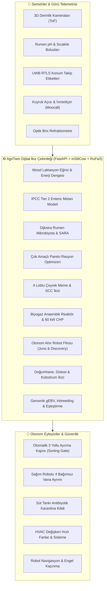

# 🐄 AgriTwin: Süt Sığırcılığı Çoklu Dijital İkiz Ekosistemi (Multi-Twin Precision Dairy Platform)

[](https://mserman90.github.io/dairy-cattle-digital-twin/)
[](https://fastapi.tiangolo.com/)
[](https://python.org)
[](https://www.icar.org)
[](https://docker.com)
[](https://pytest.org)

> **AgriTwin**, modern bir süt sığırcılığı çiftliğinin tüm biyolojik, fiziksel, robotik ve enerji varlıklarını gerçek zamanlı simülasyon ve yapay zeka ile senkronize eden, **14 farklı uzmanlaşmış alt ikizi (Multi-Twin Architecture)** tek bir karar destek ve otomasyon platformunda birleştiren endüstriyel düzeyde bir Dijital İkiz ekosistemidir.

---

## 🌐 Canlı Web Uygulaması & İnteraktif Simülatör

* 🚀 **GitHub Pages Canlı Yayını:** **[https://mserman90.github.io/dairy-cattle-digital-twin/](https://mserman90.github.io/dairy-cattle-digital-twin/)**
  *(Tarayıcıda bağımsız çalışan istemci tabanlı reaktif simülatör, canlı RTLS haritası, robot hareketleri, senaryo motoru ve Türkçe AI Asistan)*
* 🖥️ **Yerel Endüstriyel FastAPI Backend:** `http://127.0.0.1:8000`

---

## 🏛️ Çok Katmanlı Mimari (Multi-Twin Architecture)



---

## 🌟 14 Uçtan Uca İkiz Modülü & Özellikler

| Faz | Modül | Bilimsel Referans | Temel Yetenekler |
| :--- | :--- | :--- | :--- |
| **Faz 1** | **Temel Reaktif İkiz** | FastAPI, Pydantic v2 | Reaktif zaman döngüsü, 3 yönlü akıllı ayırma kapısı, Glassmorphic UI. |
| **Faz 2** | **ICAR ADE v2 Standardı** | ICAR Guideline v2.0 | Küresel hayvan veri değişim standardında JSON telemetri ve sağım aktarımı. |
| **Faz 3** | **Fizyolojik & Metan İkizi** | inSiliCow, RuFaS, IPCC Tier 2 | Wood Gamma Eğrisi $y(t) = a \cdot t^b \cdot e^{-ct}$, DMI, $NE_L$ ve $CH_4$ (g/gün) hesabı. |
| **Faz 4** | **Finansal ROI & Edge Gateway** | IOFC Modeli | 1.1 yıl amortisman süreli finansal projeksiyon, çevrimdışı yerel fail-safe ve ilaç arınma tank kilidi. |
| **Faz 5** | **Endüstriyel Dağıtım** | Docker, TimescaleDB, MQTT | Mosquitto MQTT broker, TimescaleDB IoT zaman serisi, günlük Markdown audit raporu. |
| **Faz 6** | **RTLS Mekânsal Isı Haritası** | NRC THI Formülü | $8 \times 5$ (40 hücre) mikroklima THI ızgarası, UWB inek koordinatları, Türkçe NLP AI Danışmanı. |
| **Faz 7** | **3D Bilgisayarlı Görü İkizi** | Sprecher Lameness, Elanco BCS | 3D derinlik kamerasıyla sırt kemerleşme, adım asimetrisi, topallık (1-5) ve BCS (1-5). |
| **Faz 8** | **Rumen & SARA İkizi** | Dijkstra Mikrobiyota Kinetiği | İntraruminal bolus pH kinetiği, A:P oranı, VFA derişimi ve Subakut Rumen Asidozu teşhisi. |
| **Faz 9** | **Çok Amaçlı TMR Rasyon İkizi** | Pareto Frontiers & 3-NOP | Maksimum Kâr, Düşük Metan (Bovaer) ve Dengeli Pareto rasyon optimizasyon motoru. |
| **Faz 10** | **4 Loblu Robotik Sağım İkizi** | DeLaval VMS / Lely Astronaut | Çeyrek meme bazında iletkenlik, spektroskopi, SCC, enfekte süt ayrımı ve buharla başlık dezenfeksiyonu. |
| **Faz 11** | **Biyogaz & Net-Zero Enerji** | Mezofilik Anaerobik Çürütücü | 4,320 kg/gün gübreden 506.6 kWh elektrik üretimi, %507 öz yeterlilik ve şebekeye temiz enerji ihracı. |
| **Faz 12** | **Otonom Ahır Robot Filosu** | Lely Juno & Discovery | Juno-X Yem İtici (+%3.2 DMI) ve Discovery-Vac Gübre Vakum Robotu (-%28 topallık), RTLS navigasyonu. |
| **Faz 13** | **Genomik Seleksiyon & Pedigri** | USDA-CDCB, Wright Inbreeding | $gEBV$ Net Merit ($NM\$$), Wright Akrabalık Katsayısı ($F < \%6.25$), $HCD$ genetik defekt engeli ve dişi sperma eşleştirmesi. |
| **Faz 14** | **Doğum & Distosi Erken Uyarı** | P4 Kinetiği, Moocall, Brix | Vücut sıcaklığı düşüşü ($-0.8^\circ\text{C}$), kuyruk açısı/sancı frekansı, $CES\ 3$ güç doğum alarmı, optik Brix kolostrum & APGAR Vigor buzağı ikizi. |

---

## 🧪 Senaryo ("What-If") Simülasyon Motoru

Kullanıcı arayüzünde tek tıklamayla aşağıdaki gerçek dünya zorlukları simüle edilebilir:
* `🚨 Distosi / Güç Doğum Alarmı`: 2. Evre ıkınma süresi $>70\text{ dk}$, makat gelişi, acil veteriner çağrısı ve revir yönlendirmesi.
* `🤰 Doğum Eli Kulağında`: Vücut ısısında $-0.8^\circ\text{C}$ düşüş, kuyruk dikilme açısı $>45^\circ$, doğumhane sevk.
* `🔥 Isı Dalgası (THI > 78)`: Havalandırma fanlarının ve su sisleme nozullarının otonom devreye girmesi.
* `🦠 Subklinik Mastitis`: 4 loblu robot sağımda enfekte lobun sütünün ayrılması, diğer 3 lobun tanka kabulü.
* `⚡ Kızgınlık / Estrus`: Aktivite patlaması tespiti ve en uygun genomik boğa eşleştirme önerisi.
* `🦶 Topallık & Tırnak Vakası`: 3D kamerada sırt kemerleşmesi algılanarak tırnak bakım locasına sevk.
* `🧪 Rumen Asidozu (SARA)`: $pH < 5.8$ asidoz alarmı ve sodyum bikarbonat tampon besleme tavsiyesi.
* `🌿 Çok Amaçlı Rasyon`: Metan salımını $\%16$ düşüren ve kârlılığı artıran Bovaer rasyon adaptasyonu.

---

## 🛠️ Yerel Kurulum & Çalıştırma

### Gereksinimler
* Python 3.11+
* Git

### Adımlar
```bash
# 1. Depoyu klonlayın
git clone https://github.com/mserman90/dairy-cattle-digital-twin.git
cd dairy-cattle-digital-twin

# 2. Bağımlılıkları yükleyin
pip install -r requirements.txt

# 3. Test süitini çalıştırın (15 birim & entegrasyon testi)
pytest -v

# 4. FastAPI sunucusunu başlatın
uvicorn main:app --host 127.0.0.1 --port 8000 --reload
```

Uygulamayı tarayıcınızda açın: **`http://127.0.0.1:8000`**

### Docker ile Dağıtım
```bash
docker-compose up --build -d
```

---

## 📊 REST API Uç Noktaları

| Uç Nokta | Metot | Açıklama |
| :--- | :--- | :--- |
| `/api/state` | `GET` | Tüm çiftlik, inekler, bölgeler, finans, enerji, robotik ve doğum durumu |
| `/api/simulate/tick` | `POST` | Simülasyon zaman adımını ilerletir ve telemetriyi günceller |
| `/api/simulate/scenario` | `POST` | 'dystocia', 'calving_imminent', 'heatwave', 'mastitis' senaryolarını tetikler |
| `/api/assistant/ask` | `POST` | Doğal dilde Türkçe AI Çiftlik Danışmanına soru sorar |
| `/api/calving/summary` | `GET` | Doğumhane doluluğu, distosi alarmları ve kolostrum bankası stoğu |
| `/api/calving/colostrum` | `POST` | Optik Brix refraktometre IgG ve FPT bağışıklık değerlendirmesi |
| `/api/genomics/summary` | `GET` | Sürü genomik Net Merit, inbreeding ve eşleştirme matrisi |
| `/api/genomics/mating/{id}` | `GET` | Seçilen inek için sıralanmış boğa önerileri ve genetik kısıt kontrolü |
| `/api/robotics/fleet` | `GET` | Juno-X yem itici ve Discovery-Vac gübre robotu telemetrisi |
| `/api/energy/biogas` | `GET` | Biyogaz reaktörü ve CHP kojenerasyon net-zero enerji profili |
| `/api/ration/optimize` | `GET` | Çok amaçlı Pareto TMR rasyon planları (Maks Kâr, Eko, Dengeli) |
| `/api/report/daily` | `GET` | Günlük Markdown veteriner ve denetim raporu |
| `/api/export/icar-ade` | `GET` | ICAR Animal Data Exchange v2.0 JSON standardında dışa aktarım |

---

## 📄 Lisans
Bu proje MIT Lisansı altında açık kaynak olarak sunulmaktadır.
